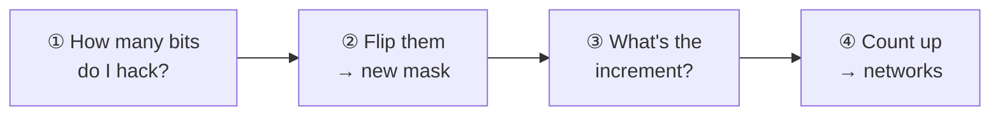

---
tags:
  - ccna/subnetting
series: NetworkChuck - You Suck at Subnetting
episode: 6
---

# EP 6 - Subnet Your Home Network

[⬅️ EP 5 - What is a Subnet Mask](EP%205%20-%20What%20is%20a%20Subnet%20Mask.md)

**Series:** NetworkChuck · *You SUCK at Subnetting* · Episode 6
**Video:** [let's subnet your home network // EP 6](https://www.youtube.com/watch?v=mJ_5qeqGOaI) · 9:39 (sponsor segments skipped: 0:45–1:58 and from 9:11) · ▶ links jump to that moment
**Basics used here:** [Subnetting (4-step method)](../Concepts/Subnetting.md) · [Binary](../Concepts/Binary.md) · [Private IP Addresses](../Concepts/Private%20IP%20Addresses.md)
**New to subnetting?** → Jump to [🎓 Subnetting Explained Clearly](#🎓%20Subnetting%20Explained%20Clearly) first.

> [!abstract] The whole lesson in 3 lines  
> 1. To split one network into several, **steal host bits** and turn them into network bits.  
> 2. Need **4** networks → 4 = 2² → steal **2** bits → `255.255.255.192` = **/26**.  
> 3. The **increment** (value of the last network bit = **64**) gives the ranges: .0–.63, .64–.127, .128–.191, .192–.255, with **62** usable hosts each.

## 1. The Goal ▶ [0:00](https://www.youtube.com/watch?v=mJ_5qeqGOaI&t=0s)

Your home network is one big flat network: `192.168.1.0/24`, mask `255.255.255.0`, **254** usable addresses. Every device (laptop, smart TV, toilet…) sits together, which is **insecure**.

The plan: split it into **4 smaller networks**: **Wireless**, **IoT**, **DMZ** and **Users**.

> [!info]- Why separate devices into different networks? (click)  
> If a cheap IoT camera gets hacked on a flat network, the attacker can reach everything. In separate networks, traffic between them has to pass a router or firewall, where it can be filtered.  
> - **IoT** = smart devices (bulbs, cameras, plugs)  
> - **DMZ** (demilitarized zone) = servers the Internet can reach, kept apart from your private stuff

## 2. Network Bits vs Host Bits ▶ [2:00](https://www.youtube.com/watch?v=mJ_5qeqGOaI&t=120s)


Convert the mask to [binary](../Concepts/Binary.md):

```
255.255.255.0 = 11111111.11111111.11111111.00000000
                └──── 24 network bits ────┘└ 8 host bits ┘
```

- **1s = network bits**: describe the network.
- **0s = host bits**: room for devices.

> [!important] The core rule  
> **Need more networks? Steal host bits** and flip them to 1 (Chuck: "bring them over to the dark side").

## 3. Step ①: How Many Bits to Steal? ▶ [3:04](https://www.youtube.com/watch?v=mJ_5qeqGOaI&t=184s)


Chuck adds a second chart under the usual one, the "brother" chart, where each value is doubled. Read it as **how many networks you get** from borrowing that many bits:

|Bits stolen|1|2|3|4|5|6|7|8|
|---|---|---|---|---|---|---|---|---|
|Networks|2|**4**|8|16|32|64|128|256|

Need **4** → that's at **2 bits**.


What if you needed **17**? 16 isn't enough, so jump to **32** → **5 bits**. Always round **up** to the next power of 2.

## 4. Step ②: Steal the Bits → New Mask ▶ [4:27](https://www.youtube.com/watch?v=mJ_5qeqGOaI&t=267s)


Flip the first 2 host bits:

```
11111111.11111111.11111111.11000000
                           └ 128 + 64 = 192
```

**New mask = 255.255.255.192**

**CIDR notation** = count the network bits: 8 + 8 + 8 + 2 = **/26**.

> [!info]- What is CIDR notation? (click)  
> **CIDR** (Classless Inter-Domain Routing) writes the mask as a slash and the number of 1-bits. `255.255.255.0` = **/24**, `255.255.255.192` = **/26**. It's shorter and is what you'll see everywhere (`192.168.1.0/26`).

## 5. Step ③: Find the Increment ▶ [5:23](https://www.youtube.com/watch?v=mJ_5qeqGOaI&t=323s)


**Increment = the value of the last network bit.** In `11000000`, the last 1 sits under **64** → increment = **64**. It's the size of each new network.

> [!tip] Shortcut  
> Increment = **256 − last mask octet** → 256 − 192 = **64**.

## 6. Step ④: Create the Networks ▶ [6:07](https://www.youtube.com/watch?v=mJ_5qeqGOaI&t=367s)

Start at 0 and keep adding 64:


|#|Use (Chuck's plan)|Network → Broadcast|
|---|---|---|
|1|Wireless|192.168.1.**0** – 192.168.1.**63**|
|2|IoT|192.168.1.**64** – 192.168.1.**127**|
|3|DMZ|192.168.1.**128** – 192.168.1.**191**|
|4|Users|192.168.1.**192** – 192.168.1.**255**|

All four use mask **255.255.255.192 /26**.

> [!warning] Off-by-one trap  
> The first network ends at **.63**, not .64. Counting from 0, 64 addresses = .0 to .63. The next network **starts** at .64.

## 7. How Many Hosts per Network? ▶ [7:03](https://www.youtube.com/watch?v=mJ_5qeqGOaI&t=423s)


Host bits left = **6** (you borrowed 2 of the 8).

```
2^6 = 64 addresses − 2 (network + broadcast) = 62 usable hosts
```

You traded size for count: 1 network × 254 hosts became **4 networks × 62 hosts**.

## 8. Homework: 5 Networks ▶ [8:08](https://www.youtube.com/watch?v=mJ_5qeqGOaI&t=488s)

Chuck's challenge: split the same `192.168.1.0/24` into **5** networks. Give the mask (decimal and CIDR) and the ranges.

> [!success]- Answer (try first!)  
> ① 5 isn't a power of 2 → round up to **8** → **3 bits**  
> ② `11100000` = 224 → **255.255.255.224 = /27**  
> ③ Increment = **32**  
> ④ .0–.31 · .32–.63 · .64–.95 · .96–.127 · .128–.159 · .160–.191 · .192–.223 · .224–.255  
> That's **8** networks (use 5, keep 3 spare), each with 2⁵ − 2 = **30** usable hosts.

The same 4 steps work for Class A and B too. They just feel different at first. → [Subnetting cheat table](../Concepts/Subnetting.md#%2F24%20Cheat%20Table%20%28last%20octet%29)

---

# 🎓 Subnetting Explained Clearly

*This part is a stand-alone lesson using only Chuck's method from this episode. If the video sections above felt fast, read this part on its own, top to bottom.*

## A. What Subnetting Is, in One Picture

> [!abstract] One sentence  
> **Subnetting = cutting one big network into several smaller networks** by moving the line between the network part and the host part of the address.

> [!tip] Analogy: cutting a pizza 🍕  
> Your `/24` home network is **one pizza with 256 bites** (addresses).  
> - Cut it into **4 slices**, and each slice has **64 bites**.  
> - Cut it into **8 slices**, and each slice has **32 bites**.  
> **More slices = smaller slices.** You never get more pizza, you only divide it differently.

## B. The One Idea Behind Everything: Moving the Line

An IPv4 address always has **32 bits**. The subnet mask draws a **line** through them:

- left of the line (mask **1s**) = **network bits**: *which* network
- right of the line (mask **0s**) = **host bits**: *which device*

```
Before  /24:  11111111.11111111.11111111 | 00000000     1 network, 8 host bits
After   /26:  11111111.11111111.11111111.11 | 000000    4 networks, 6 host bits
                                         ↑↑
                          2 host bits "hacked" to the network side
```

> [!important] The rule  
> **Move the line right** (steal host bits) → **more networks, fewer hosts** each.  
> Every bit you steal **doubles** the number of networks and **halves** the size of each one.

## C. Chuck's Two Charts

Write **both** charts on paper, one under the other, before you start.

```
Nosferatu (bit values):          128   64   32   16    8    4    2    1
Nosferatu's brother (×2):        256  128   64   32   16    8    4    2
```

|Chart|What it's for|How to read it|
|---|---|---|
|**Nosferatu** (top)|Converting bits ↔ decimal; finding the **increment**|The value **above** a bit|
|**Nosferatu's brother** (bottom)|**Counting**: how many networks or addresses *n* bits make|Count **n columns from the right** → that number = 2ⁿ|

> [!info]- Why does counting from the right in the brother chart work? (click)  
> Reading from the right, the brother chart is 2, 4, 8, 16 … = 2¹, 2², 2³, 2⁴ … So "count 2 columns from the right" lands on **4** = 2². That's exactly how many combinations 2 bits can make: `00`, `01`, `10`, `11`. → [Binary](../Concepts/Binary.md)

## D. The 4 Steps (Ask Yourself These Questions)



|Step|Ask yourself|How|Example: 4 networks from 192.168.1.0/24|
|---|---|---|---|
|**①**|How many host bits must I hack?|Brother chart: count from the right until you reach **≥** the networks you need|2 → 4 ✅ = **2 bits**|
|**②**|What's my new mask?|Turn those host bits into 1s, then convert with Nosferatu|`11000000` = 128 + 64 = **192** → **255.255.255.192 /26**|
|**③**|What's the increment?|The Nosferatu value **above the last 1** in the mask|Last 1 is under **64** → increment **64**|
|**④**|What are my networks?|Start at 0 and keep adding the increment. Each network ends **1 before** the next one starts.|.0 · .64 · .128 · .192|

**Bonus:** usable hosts per network = 2^(host bits left) − 2 = 2⁶ − 2 = **62**.

## E. See *Why* the Networks Are .0, .64, .128, .192

The 2 hacked bits can only take 4 values: `00`, `01`, `10`, `11`. Each value is **one network**:

|Hacked bits|Last octet in binary (first address)|Decimal|Network|Range|
|---|---|---|---|---|
|**00**|**00**000000|0|1 · Wireless|.0 – .63|
|**01**|**01**000000|64|2 · IoT|.64 – .127|
|**10**|**10**000000|128|3 · DMZ|.128 – .191|
|**11**|**11**000000|192|4 · Users|.192 – .255|

Inside each network, the **6 remaining host bits** run from `000000` (network address) to `111111` (broadcast):

```
Network 2:  01|000000 = .64   ← network address (not usable)
            01|000001 = .65   ← first usable host
            ...
            01|111110 = .126  ← last usable host
            01|111111 = .127  ← broadcast (not usable)
```

> [!important] That's the whole secret  
> The networks go up in steps of **64** because 64 is the value of the **last hacked bit**. Changing that bit from 0 to 1 jumps you to the next network. That's why it's called the **increment**.

## F. Before vs After

| |**Before** (/24)|**After** (/26)|
|---|---|---|
|Mask|255.255.255.0|255.255.255.192|
|Network bits / host bits|24 / 8|26 / 6|
|Number of networks|1|**4**|
|Addresses per network|256|64|
|Usable hosts per network|254|**62**|
|Lost to network + broadcast|2|8 (2 in each of 4 networks)|

> [!info]- Why do we "lose" more addresses after subnetting? (click)  
> **Every** network needs its own network address and broadcast address. 1 network costs 2 addresses; 4 networks cost 8. That's the price of separating your devices: 4 × 62 = 248 usable, vs 254 before.

## G. Second Example: Chuck's "17 Networks"

① Brother chart from the right: 2, 4, 8, 16 ❌ (too few), **32** ✅ → **5 bits**
② `11111000` = 128+64+32+16+8 = **248** → **255.255.255.248 /29**
③ Last 1 is under **8** → increment **8**
④ .0 – .7 · .8 – .15 · .16 – .23 … up to .248 – .255 → **32 networks** (use 17, keep 15 spare)

Hosts: 3 host bits left → 2³ − 2 = **6** usable per network.

> [!warning] Round **up**, never down  
> 16 networks can't hold 17. You can't borrow "4.1 bits", so always jump to the next power of 2.

## H. Common Mistakes

|Mistake|Fix|
|---|---|
|Ending the first network at .64|It ends at **.63**: the next network **starts** at .64|
|Rounding down (17 → 4 bits)|Round **up** to the next power of 2 (17 → 32 → 5 bits)|
|Using the increment from the wrong chart|Increment comes from the **top** (Nosferatu) chart, above the **last 1**|
|Forgetting the −2|Usable hosts = addresses − **2** (network + broadcast)|
|Hacking bits from the left of the mask|Always hack the **first host bits**, right after the existing 1s|

## I. 60-Second Recap

1. Subnetting = **moving the line** between network bits and host bits.
2. **Brother chart** → how many bits to hack. **Nosferatu chart** → new mask value and the increment.
3. **Increment** = value above the last 1 = gap between networks.
4. **Hosts** = 2^(host bits left) − 2.
5. More networks ⇄ fewer hosts. You're slicing the same pizza.

---

## 9. Revision Sheet

|Step|Do|This example|
|---|---|---|
|①|Bits to steal = smallest 2ⁿ ≥ networks needed|4 → **2 bits**|
|②|Flip those host bits → new mask|**255.255.255.192 /26**|
|③|Increment = value of last network bit (or 256 − mask)|**64**|
|④|Count up by the increment|.0 · .64 · .128 · .192|
|Hosts|2^(host bits) − 2|2⁶ − 2 = **62**|

## 10. Test Yourself

Answer first, then click to check.

> [!question]- You need 3 networks from a /24. How many bits do you borrow, and what's the mask?  
> Round up to 4 → **2 bits** → **/26 (255.255.255.192)**

> [!question]- You need 17 networks. How many bits?  
> 16 < 17 ≤ 32 → **5 bits**

> [!question]- Mask 255.255.255.224: increment?  
> 256 − 224 = **32**

> [!question]- In 192.168.1.0/26, which network does 192.168.1.100 belong to?  
> **192.168.1.64/26** (range .64–.127)

> [!question]- What's the broadcast address of 192.168.1.128/26?  
> **192.168.1.191**

> [!question]- How many usable hosts in a /26?  
> 2⁶ − 2 = **62**

> [!question]- Borrowing more bits does what to the number of networks and to hosts per network?  
> Networks **double** per bit, hosts per network **halve** (roughly).
